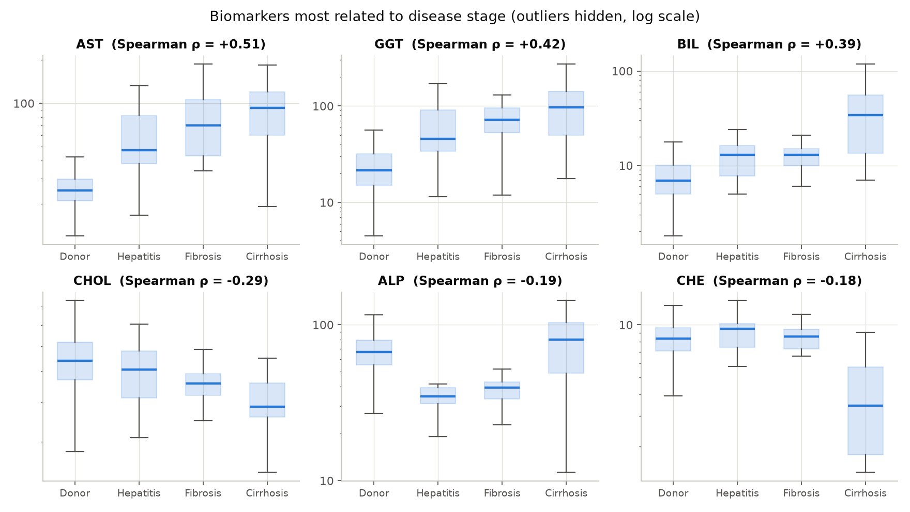
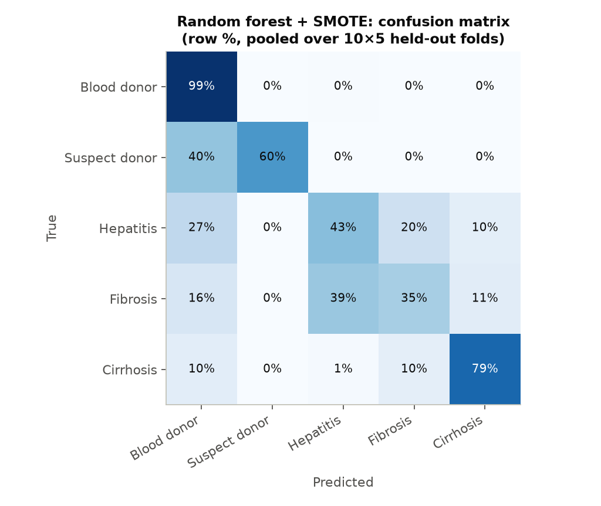
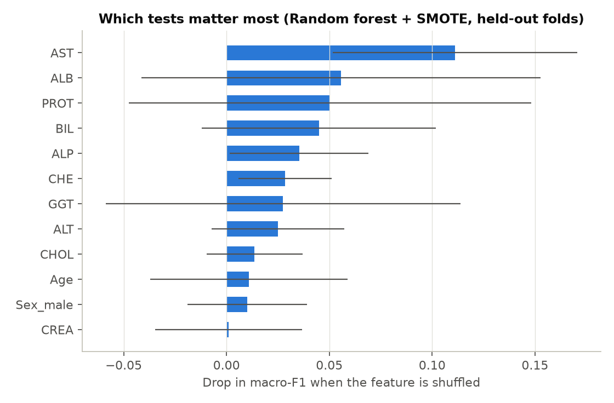

# Hepatitis C stage classification from routine blood tests

Classifying 615 patients of the UCI **HCV dataset** into blood donor, suspect donor, hepatitis, fibrosis
or cirrhosis from age, sex and 10 laboratory values (ALB, ALP, ALT, AST, BIL, CHE, CHOL, CREA, GGT, PROT).

The dataset is small and very imbalanced: 533 of the 615 patients are healthy donors. Overall accuracy
is therefore misleading (predicting "donor" for everyone gives 87%), so this analysis reports **balanced
accuracy, macro-F1 and per-class recall**, estimated with **repeated stratified cross-validation**.

## Results

All numbers below are produced by `hepatitis_analysis.py` (see [`results/`](results/)).

### Which biomarkers change with disease stage?

Spearman correlation between each test and the ordered stage (donor 0 → hepatitis 1 → fibrosis 2 →
cirrhosis 3). Suspect donors are not a stage and are left out of this step.

| Biomarker | Spearman ρ | p-value |
|---|---|---|
| AST | +0.51 | 1.6e-41 |
| GGT | +0.42 | 4.3e-27 |
| BIL | +0.39 | 4.4e-23 |
| CHOL | −0.29 | 8.6e-13 |
| ALP | −0.19 | 4.8e-06 |
| CHE | −0.18 | 9.6e-06 |
| ALB | −0.17 | 2.7e-05 |



AST, GGT and bilirubin rise with stage. Cholinesterase (CHE), a marker of the liver's synthetic
function, drops sharply in cirrhosis; albumin is also lower in later stages (ρ = −0.17).

### Classifiers (repeated stratified 5-fold CV × 10, mean ± std, %)

| Model | Accuracy | Balanced acc. | Macro-F1 | Recall: donor | suspect donor | hepatitis | fibrosis | cirrhosis |
|---|---|---|---|---|---|---|---|---|
| Logistic regression (class-balanced) | 88.3 ± 3.1 | **70.3 ± 10.9** | 61.9 ± 10.0 | 92 | 79 | 60 | 49 | 70 |
| LDA | 92.5 ± 1.7 | 58.5 ± 12.2 | 60.5 ± 11.8 | 100 | 64 | 34 | 29 | 65 |
| Random forest | 92.4 ± 1.6 | 51.4 ± 9.6 | 52.7 ± 10.6 | 99 | 17 | 27 | 33 | 80 |
| Random forest + SMOTE | **93.2 ± 1.5** | 63.5 ± 9.3 | **63.6 ± 8.8** | 99 | 62 | 43 | 35 | 79 |



- **SMOTE helps the random forest.** Balanced accuracy rises from 51.4% to 63.5%, mostly because
  suspect donors and hepatitis patients are found more often.
- **No single best model.** Random forest + SMOTE has the best macro-F1. Class-balanced logistic
  regression finds the minority stages most often (best balanced accuracy, recall 60% for hepatitis
  and 49% for fibrosis), at the cost of more false alarms among donors (recall 92%). The standard
  deviations are large because the rare classes have only 7–30 patients.
- **Hepatitis and fibrosis are hard to separate.** 39% of fibrosis patients are predicted as hepatitis.
  These two adjacent stages have similar blood values. Cirrhosis is recognised best among the
  disease stages (79%).

### Which tests does the model use?

Permutation importance measured on held-out folds: the drop in macro-F1 when one feature is shuffled.



AST matters most, followed by ALB, PROT, BIL and ALP.

## Method

- **No leakage.** Median imputation, scaling and SMOTE are steps of an `imblearn` pipeline, so they
  are fitted on the training folds only and never see the test fold.
- **Evaluation.** Repeated stratified 5-fold cross-validation (10 repeats, 50 test folds), instead of a
  single 70/30 split in which some classes would have only 2–3 test patients.
- **Correlation.** Rank (Spearman) correlation with the ordered stages. The class labels are
  categories, so an alphabetical label encoding is not a valid numeric target.
- **Importance.** Permutation importance on held-out data, rather than impurity-based random-forest
  importance, which is biased towards continuous features.

## Run it

```bash
pip install -r requirements.txt
python hepatitis_analysis.py      # downloads the data from UCI, writes results/ and figures/
python -m pytest -q tests         # leakage checks
```

The GitHub Actions workflow runs the tests on every push. It also re-runs the full analysis when
started from the Actions tab.

## Limitations

- **Small rare classes.** Only 7 suspect donors, 24 hepatitis, 21 fibrosis and 30 cirrhosis patients.
  Per-class numbers have wide uncertainty.
- **Single source.** One dataset from one source with no external validation, so the results may not
  transfer to other laboratories or populations.
- **No clinical use.** This is an educational analysis, not a diagnostic tool.

## Data

Lichtinghagen R., Klawonn F., Hoffmann G. (2020). *HCV data* [Dataset]. UCI Machine Learning Repository.
DOI: [10.24432/C5D612](https://doi.org/10.24432/C5D612). License: CC BY 4.0.
<https://archive.ics.uci.edu/dataset/571/hcv+data>
